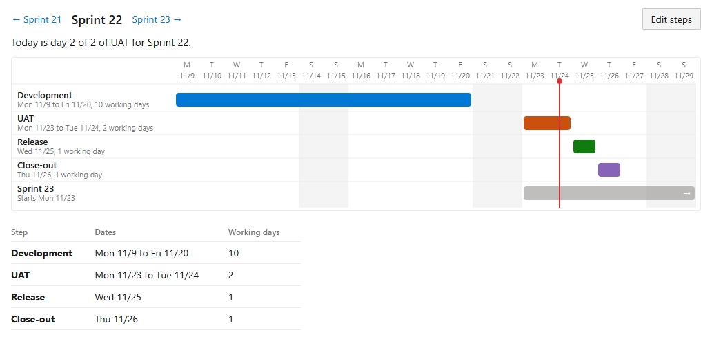
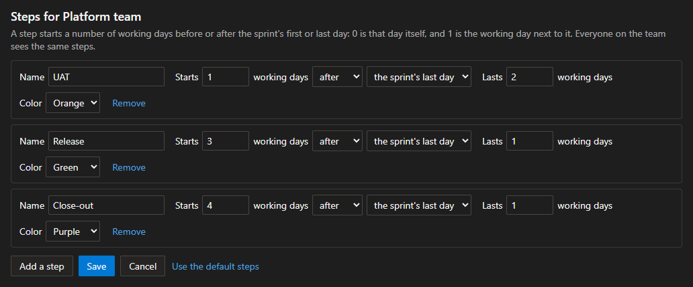
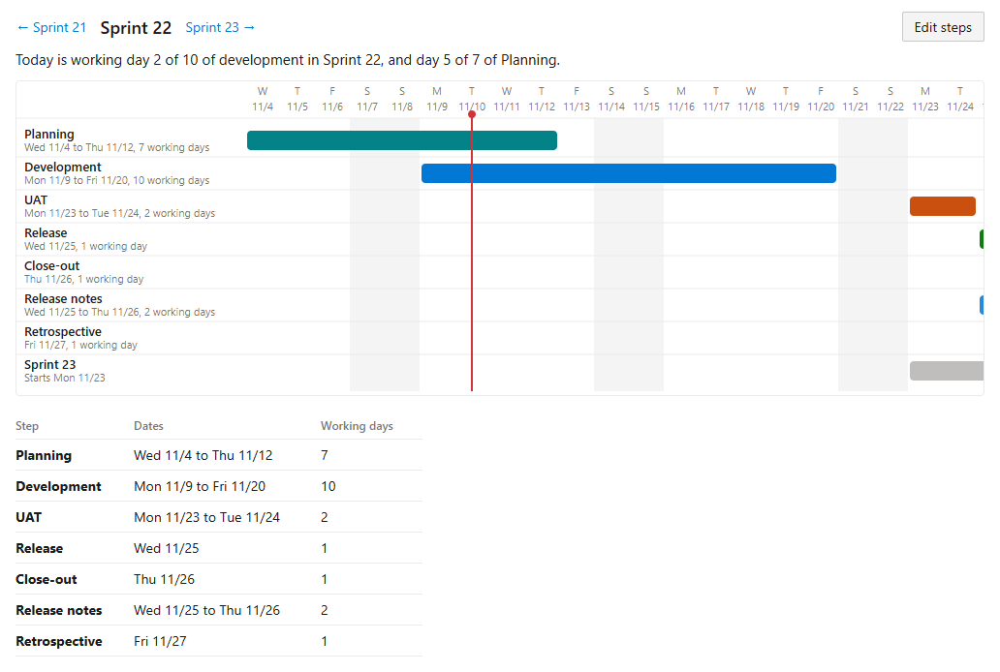
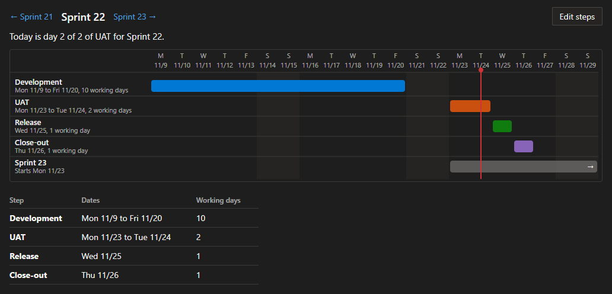

# Sprint Timeline

An Azure DevOps sprint has two dates: when development starts and when it ends.
Many teams run steps around that: planning before it, then UAT, a release and a close-out after it.
Sprint Timeline adds a **Timeline** tab to the Sprints page that shows the whole sprint, with every step your team runs around development.

## What it shows

- One bar for development, one bar for each step, and one for the next sprint, so you see where they overlap.
- A red line for today, and a sentence that says where today falls, such as "Today is day 2 of 2 of UAT for Sprint 22."
- Weekends and other non-working days shaded, from your team's working days.
- A table of the same dates, for a screen reader and for copying.
- Buttons to step to the sprint before or after.

## Set your team's steps

Select **Edit steps** to name your steps.
Each step starts a number of working days before or after the sprint's first or last day, and lasts a number of working days.
Everyone on the team sees the same steps.

The default steps are UAT on the first two working days after the sprint, the release on the third and the close-out on the fourth.

A step that starts before the sprint, such as planning, is drawn above development.

## Light and dark

The tab follows your Azure DevOps theme.

## What it reads and stores

- It reads your team's sprints and working days.
- It stores your team's steps in the extension's own data storage in your organization.
- It sends no data anywhere else, and it has no telemetry.
- It needs only the scope **Work items (read)**.

## Source

MIT license. The source is on [GitHub](https://github.com/turnert2005/sprint-timeline).
